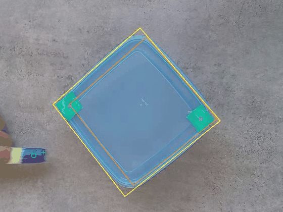
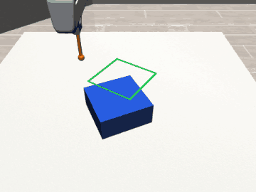
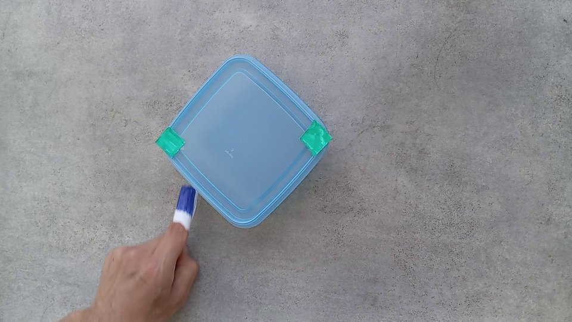
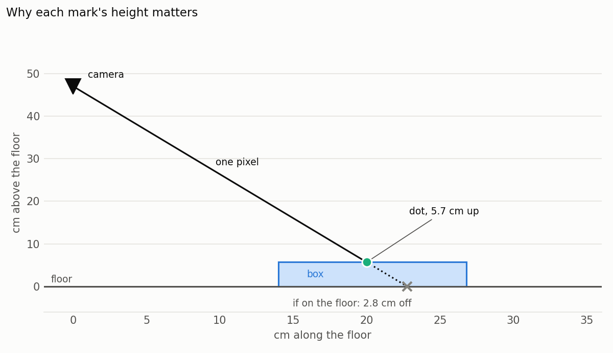
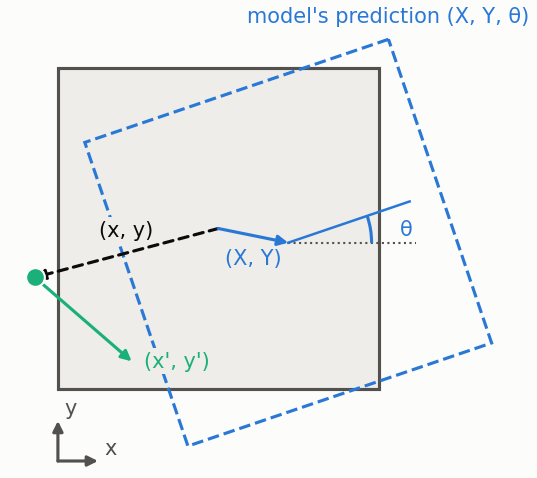
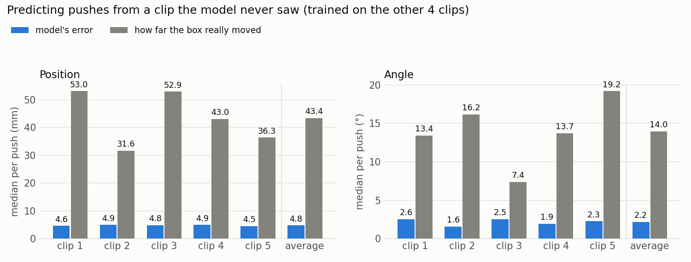
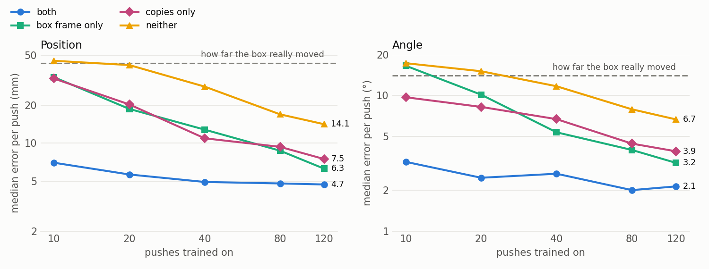
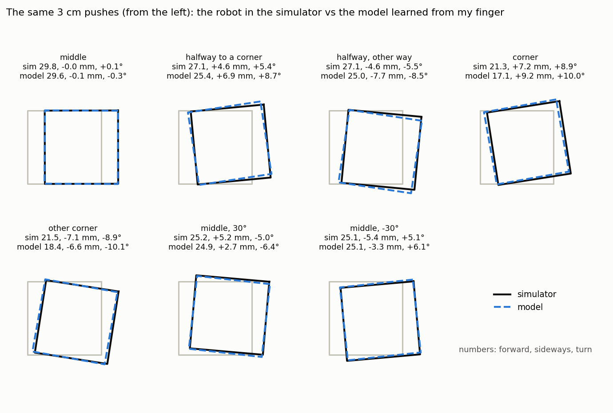
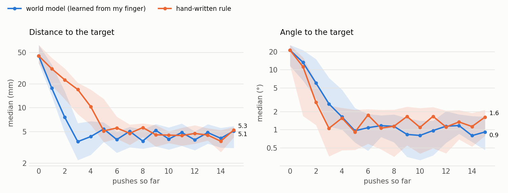
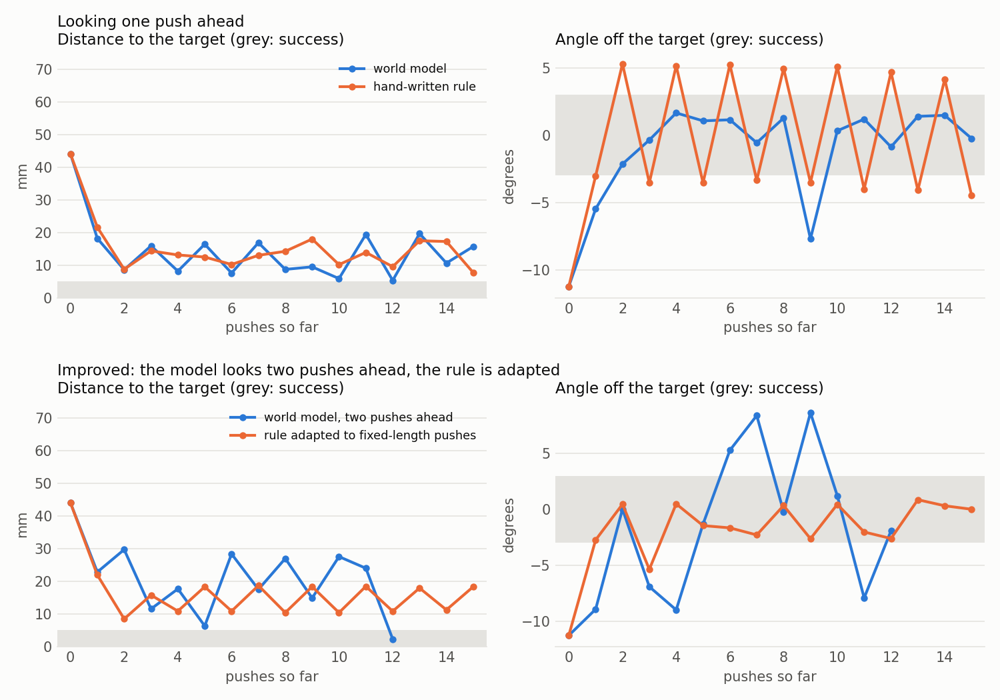

## Preface

I don't come from a robotics background. However, if there is one thing the favorite platform for bloodthirsty recruiters (aka LeetCode) taught me, it is to always look for the invariants.

What does this mean in our problem? We want to give a robot data of us performing tasks, and have it replicate them. But obviously we don't all have grippers for hands, so... how can we transfer?

My hypothesis was the following: what is similar between a robot learning a task and a human accomplishing it? The obvious answer? Physics.

Let's say we have a simple problem, e.g. moving a box. How the box moves doesn't depend on what pushes it. A fingertip and the tip of a robot arm, touching the same spot and moving the same way, should push the box the same way. So instead of recording where my finger is on the floor, I record where it **is** relative to the box, and which way it **moves** relative to the box. A robot can be given exactly the same description, so to the model, my finger and the robot should become the same thing.

To test this, I filmed myself pushing a box with one finger (5 clips, 21 minutes, 150 pushes) and tracked the box and my fingertip with OpenCV. I then trained a world model to predict how the box moves when pushed, and used it to drive a simulated Panda arm. No robot data went into training.

<p align="center">
  
  
</p>
<p align="center"><em>Left: my finger pushing the box, as tracked. 
Right: the simulated robot pushing the box onto a target, choosing each push with the model learned from my finger.</em></p>

- On the task of pushing the box onto 30 random targets, the robot gets the box within 5 mm and 1° of every single one.

- Under cross validation (train on 4 clips, test on the 5th), the model predicts pushes it never saw with a typical error of 4.8 mm and 2.2°, while the box moved 43 mm and turned 14° on a typical push.

- To push the initial idea further, I added two more invariants. 
    1) Measuring pushes from the box also means it doesn't matter where the box sits on the floor or which way it faces. 
    2) Since the box is square, turning or mirroring a push gives another valid example, so every recorded push becomes 8. 

    With these two tricks, training on 10 real pushes beat 120 pushes without them (7 mm off against 14 mm).

- Limitations: the task is simple enough that a hand-written rule does as well as the model. It gets harder when every push must be exactly 3 cm: then one push at a time isn't enough, and both mostly fail. But the model can predict where a sequence of pushes will leave the box before doing any of them. Looking two pushes ahead, the robot reaches 26 of 30 targets. A rule that also plans several pushes ahead, or an RL policy, would probably manage too (not tried). The point is that the same model handled it without any change.

**Contents:** [Problem](#problem) · [Methodology](#methodology-overview) · [Getting the data](#getting-the-data) · [Transforming the data](#transforming-the-data) · [World model](#feeding-it-to-the-world-model) · [The robot](#the-robot) · [Results](#results-and-questions) · [Design choices](#design-choices) · [What worked and what didn't](#what-worked-and-what-didnt) · [Repo structure](#repo-structure) · [How to run](#how-to-run) · [Use of AI](#use-of-ai) · [About me](#about-me)

**Results:** [1. Unseen pushes](#1-does-the-model-predict-pushes-it-has-never-seen) · [2. Invariants](#2-what-are-the-invariants-worth) · [3. Physics](#3-did-it-learn-the-physics) · [4. Robot](#4-can-the-robot-use-it) · [5. How close](#5-how-close-can-each-get) · [6. Fixed 3 cm pushes](#6-a-harder-task-every-push-exactly-3-cm)


## Problem

**Given videos of me pushing a box, can a simulated robot push it to a target position and angle?**

The angle is harder, since how much the box turns depends on where we push it. That's why I used a square box rather than a plate. (Sue me for not having a rectangular or T shaped tupperware.)


## Methodology overview

Here is the basic idea of this project:

-   **Data**: I collected the data by filming myself pushing a box around with my finger.

-   **Perception**: I need to transform this into something usable by a world model. To do so, I track where the box and my finger are in every frame, and keep 10 samples a second as training data.

-  **Model**: A world model is then trained to predict, given where the finger is relative to the box and how it moves, how the box slides and turns in the next 0.1 s. Ideally, we want the model to learn the rule: "if the finger is here and moves like this, the box slides and turns like that".

-   **Planning**: Finally, our simulated robot has to push a box to a target spot. So, we ask it to generate lots of candidate pushes, feed them to the model, then select the action the model predicts gets it closest to the goal.

-   **Evaluation**: I checked three things. Can the model predict pushes from clips it never saw? Can the robot actually reach targets with it, and how does it compare to a hand-written rule? And what is each invariant worth, by training the model without them?


## Getting the Data

- **Setup.** Phone lying on a chair seat, camera sticking out, looking down at the floor from about 47 cm. 1080p, 30 fps, stabilisation and HDR off.

- **Lens calibration.** I used a checkerboard (`data/calibration/checkerboard_9x6.pdf`) shown full screen on my laptop, filmed from many positions and tilts, then used OpenCV to fit the focal length, image centre and distortion (0.66 px error over 100 views). (`video/calibrate.py`) 

- **Box.** A blue plastic tupperware I had, 12.8 cm square and 5.7 cm tall. (My setup was so scuffed, I literally had nothing where I was when building, including a ruler. My measurements were done with a credit card, and a pot of ratatouille was used to hold my phone). Two green tape squares in opposite corners of its top: their middle is the box's centre.

- **Finger.** A white paper sleeve with a blue band, so the fingertip is easy to find.

- **Scale.** Every clip starts with an A4 sheet lying flat for 3 seconds: its known size (29.7 × 21 cm) tells where the camera is, and turns pixels into millimetres on the floor.

- **Data.** 5 clips of about 4 minutes (21 minutes in total) of slow pushes, about 2 cm/s, with the box turned by the other hand every few pushes. The raw clips and the calibration video are on [Google Drive](https://drive.google.com/drive/folders/1wPU-c3CMfaJyeo-60HNu9z2fGGjO4f7z?usp=sharing) (too big for GitHub).




*Note: I used coloured markers and an A4 sheet because I had very little time, so I stitched together the simplest setup I could think of that would still track what I needed accurately. With more time, I'd definitely have liked to try segmentation and depth models, which work zero-shot on any object, with no markers, on a more complex messy setup than this.*

## Transforming the Data

**Tracking** (`video/track.py`), to be able to calculate positions, I need to be able to track the object. To do so:

1. The box is found by its blue colour, then the two green dots on it and the blue band on my finger next to it (I used `video/pick_colours.py` beforehand to select the colors to look for in the tracker).

2. The pixels then need to be turned into positions on the floor, accounting for each mark's height.

   

3. The box's position is the middle of the two dots, and its angle comes from the line between them (they sit on the diagonal). The square drawn in the GIF at the top is the tracked box, drawn on the real video.

*Note: The A4 sheet was fitted to within 0.7 to 1.8 px in every clip, and the camera height came out at about 47 cm each time (46.6 to 47.6). The distance between the two dots, which can't change, was measured at about 142 mm with a frame-to-frame spread of 0.6 to 1.5 mm: that spread is the tracking noise.*

**Cutting into pushes** (`video/build_dataset.py`): Positions jitter by about a millimetre from frame to frame, so the tracks are smoothed, then sampled every 0.1 s: long enough that the box moves more per step (about 2 mm at my pushing speed) than the tracking noise (about 1 mm), and short enough that a push still has 10 to 20 steps. I defined a push as a stretch where the box moves while the fingertip is right next to it, plus the moment just before (the finger closing in, box still) and just after (both stopped), so the model also learns when the box doesn't move. Of 345 candidates, 156 were dropped because the box or fingertip was lost for a moment. A few more went because the box only moved for a moment or my other hand moved it. 150 pushes were left (30, 29, 23, 25 and 43 per clip), about 2,000 samples at 10 a second.


**Lining up finger and robot.** The tracker follows the middle of the blue band, about 17.7 mm behind my fingertip (when the box starts moving, my fingertip touches its side, and the band's middle is 17.7 mm from that side), so I corrected every finger position (17.7 - 8 = 9.7 mm) towards the box, so that "touching" looks the same for both me and the robot.


## Feeding It to the World Model

**Training.** The model is very simple and answers the following question, 0.1 s at a time: *the pusher is here and moves like this; how does the box move?*

- **Inputs (4 numbers):** where the finger is relative to the box's centre (x,y), and how it moves in the next 0.1 s (x',y'), both in the box's own frame.
- **Outputs (3 numbers):** how far the box slides (x, y) and turns in that 0.1 s, in its own frame.

<p align="center">
  
</p>
<p align="center"><em>One 0.1 s step, in the box's own frame (motion drawn 5× bigger).</em></p>

- **Network:** small MLPs (4, 128, 128, 3). Five of them, each trained on a different random resample of the pushes and predictions averaged. Basically bagging models but with an MLP.
- **Augmentations:** a square box looks the same turned by a quarter turn or mirrored, so every example is shown in all 8 turned and mirrored versions.

Training takes about a minute on a laptop CPU.


**Evaluation.** Cross validation: trained on 4 clips. For evaluation, I roll out every push of the 5th clip and compare where the box ends up with where it really did (Results 1).


## The robot

A Panda arm in robosuite (MuJoCo) holds a stick with an 8 mm-radius ball on its end, which pushes the box at mid-height, slowly (3 cm/s). I thought this would be the most similar setup to my fingertip push. Before each push, the planner makes up 500 random pushes (which side, where on it, which angle, how far). Each one is turned into the ball's path, a straight line at 3 cm/s, and the world model rolls it out 0.1 s at a time to see where the box would end up. The robot does the best one, then looks at the box again and repeats, for at most 15 pushes.

For comparison, I used a **hand-written rule** (which I assumed should already be a good baseline since the problem is easy): push near a corner if its angle is off, otherwise push it straight at the target through the middle.


## Results and Questions

### 1. Does the model predict pushes it has never seen?

*Made by `wm/cross_validate.py`, which writes `data/cross_validation.json`; figure: `results/make_figures.py cross_validation`.*

Evaluation is done with cross validation, as described above.



On a typical push the box moved 43 mm and turned 14°, and the model was off by 4.8 mm and 2.2°: about a ninth of the movement and a sixth of the turn, steady across clips.

### 2. What are the invariants worth?

*Made by `wm/cross_validate.py` (with `--pushes`, `--without`, `--with-copies`), which writes `results/invariants/`; figure: `results/make_figures.py invariants`.*

I fed 3 invariants to the model. But are they useful?

1. **The pusher is just a point.** Finger or ball, only where it is and how it moves matter. Obviously, this is what lets the video teach the robot at all, so it can't be taken away and tested.

2. **The box frame.** Everything is measured relative to the box, so where it sits on the floor and which way it faces don't matter.

3. **The square's symmetry.** Every push is also shown turned by quarter turns and mirrored: 8 versions of each.

To see what 2 and 3 are worth, I ran an ablation: the same cross validation with four versions of the model, each trained on 10, 20, 40, 80 or all pushes, and evaluated on unseen clips:

- **both**: *the model used everywhere else*
- **box frame only**: *no turned or mirrored copies*
- **neither**: *no copies either, and the model gets raw floor positions as the camera sees them (8 numbers instead of 4), so it has to work out by itself that only the finger's position relative to the box matters.*
- **copies only**: *raw floor positions, but each push is still turned and mirrored about the box's own centre.*


<br>



<br>

- With all the invariants, 20 pushes beat 120 pushes without the copies (5.6 mm and 2.5°, against 6.3 mm and 3.2°), and 10 pushes beat 120 with neither (7.0 mm and 3.2°, against 14.1 mm and 6.7°).
- With all invariants the position error stops improving after about 40 pushes (4.9 mm at 40, 4.7 mm with all of them). The angle is noisier (2.5° at 20, 2.7° at 40, 2.0° at 80), so I can't say where it levels off. Given more time I would like to understand why.
- Each one alone helps about equally with all the data: 6.3 mm and 3.2° (box frame only), 7.5 mm and 3.9° (copies only), against 14.1 mm and 6.7° with neither. But only both together work with few pushes: with 10 pushes, 7.0 mm and 3.2°, against about 33 mm for either alone. On the angle, the copies alone did better at 10 pushes (9.7° against 16.6°), but the order flips at 40 pushes (6.7° against 5.4°), so that may just be noise.

- **Caveats.** With few pushes, the result depends on which ones were picked (each point is one random pick) so we might accidentally get little variability in the pushes making it impossible for the network to generalize.

### 3. Did it learn the physics?

*Made by `wm/physics_check.py`, which writes `results/physics_check.json` and the figure.*

Here the experiment consisted in performing 7 simple pushes, 3 cm into the side facing the robot, done by the robot in the simulator and predicted by the model trained on my finger, to see if the model transferred to the simulation:



- Mirrored pushes mirror, but that was given to the model (the copies), so it isn't a discovery.
- The model turns the box 1 to 3° more than the simulator on off-centre pushes. I suppose the error is either from the simulation parameters or the actual model failing to predict accurately. I have not checked which one.

### 4. Can the robot use it?

*Made by `plan/planner.py` (`--policy model` or `rule`, `--within`), which writes `results/plan_video*.json` and `results/plan_rule*.json`.*

In the previous task, we saw that the predictions were not exactly perfect but decent. The question is, is it enough? To test this, on the simulated robot, I drew 30 random targets, each 3 to 8 cm away and turned up to 45°. I then compared the world model to the hand-written rule on reaching the target, and studied precision by varying target constraints:

| Counts as reached | World model | Hand-written rule |
|---|---|---|
| within 15 mm and 10° | 30/30, 2.6 pushes on average | 30/30, 2.9 pushes |
| within 5 mm and 3° | 30/30, 3.5 pushes | 30/30, 4.0 pushes |
| within 5 mm and 1° | **30/30**, 5.8 pushes | **27/30**, 5.3 pushes when reached |

The robot, guided only by a model learned from my finger, performs as well as the hand-written rule with slightly fewer pushes (genuinely not by much so it might be noise), and still reaches every target when the angle has to be within 1°, where the rule starts missing. The targets are easy enough that the rule also succeeds most of the time, so this shows the model is as good, not that it is better. I tried to make the task harder in section 6.

### 5. How close can each get?

*Made by `plan/planner.py --within 0.1 0.1`, which writes `results/plan_*_precision.json`; figure: `results/make_figures.py convergence`.*

With a tolerance so small it is never reached (0.1 mm, 0.1°), both keep pushing for all 15 pushes, which shows how fast and how close each gets:



*Lines: median over the 30 targets; shaded: where the middle half of them fall.*

The model-guided robot closes in on the position much faster (3.7 mm after 3 pushes, against 17 mm for the rule), because it picks pushes that slide and turn the box at once. The rule fixes the angle first, so it is ahead on the angle for the first pushes. After about 5 pushes both stay around 4 to 5 mm: their shortest push is 1 cm, so once close, every extra push just moves the box around the target. On the angle, the model then stays a little closer (about 0.9° against 1.1 to 1.7° for the rule, whose fixed corner push overshoots).

### 6. A harder task: every push exactly 3 cm

*Made by `plan/planner.py --length 0.03` (with `--ahead 2`, or `--policy rule-offset`), which writes `results/plan_*_3cm*.json`; figure: `results/make_figures.py three_cm`.*

On the main task the hand-written rule does as well as the model, so it doesn't show what learning adds. I fixed every push at 3 cm, which takes away the rule's main control (how far to push) and leaves only where and at what angle. Same 30 tasks, success within 5 mm and 3°:

| | Reached | Pushes when reached (mean) | Final distance, angle (median) |
|---|---|---|---|
| world model, one push ahead | 6/30 | 4.0 | 12 mm, 1.3° |
| **world model, two pushes ahead** | **26/30** | 6.7 | **3.0 mm**, 1.7° |
| hand-written rule | 3/30 | 2.7 | 14 mm, 3.8° |
| rule adapted to fixed-length pushes | 2/30 | 2.0 | 14 mm, **0.9°** |

Within 15 mm and 10°, all of them reach 30/30 (model 2.7 pushes, rule 3.2, adapted rule 3.2).



- One push ahead, nobody lands the position. Once the box is close, any 3 cm push overshoots it.
- The rule also bounces on the angle: every corner push turns the box about 9°. Adapting it to hit nearer the middle fixes the angle (best final angle, 0.9°), but it had to be redesigned by hand, and it still can't land the position.
- Two pushes ahead, the model can set up the last push: it moves the box to a spot from which a single 3 cm push lands on the target, which looking one push ahead can't do. 26 of 30, with the same model and nothing retrained.
- Limit: a rule that also plans ahead, or an RL policy, might manage too. Not tried.


<br>

<br>


## Design choices

Most choices came from the same question: what would make my finger and the robot look the same to the model? That's why every push is described from the box's point of view, and why every push is also shown turned and mirrored. With both, 10 pushes beat 120 pushes without them (Results 2). It's also why the robot pushes with a ball on a stick rather than its gripper. The closed gripper would push like a ruler, while a ball touches at one point, like a fingertip. And it's why I pushed slowly. At a couple of centimetres a second the box stops the moment the pusher stops, so what it does depends on where and how it's pushed, not on its weight or speed. So it doesn't matter that my finger (about 2 cm/s) and the robot (3 cm/s) push at different speeds, or that the simulated box's weight is a guess.

For the filming, I went for whatever needed no measuring that I could get my hands on. An A4 sheet is the same size everywhere, so it gives the camera's position and the scale quickly. The box got two green dots in opposite corners, their middle is exactly the box's centre, and unlike the white strip I initially started with, green doesn't get mixed up with a light grey floor.

The individual models were chosen to be small (4 numbers in and 3 out), because the representation (the box's point of view) was the best I could come up with and does most of the work. 150 pushes is also small, so that was also a factor. Objectively this functions pretty well since the problem is so simple. The size is also why I allowed myself to bag multiple estimators, although the initial idea was to use a trick I came across in semi-supervised learning where you can quantify the "confidence" of a prediction directly by evaluating to what extent the estimators agree.

The test split was selected on whole clips the model never saw, because pushes from one clip share the light and maybe the way I held my finger.

Also, the planner score might seem random. Not gonna lie, it was because the first tolerance I tested was 15 mm and 10 degrees, which is why I used score = mm off ÷ 15 + degrees off ÷ 10.

The robot also looks at the real box again before every push and plans the next one from there. That's how it lands within 5 mm and 1° even though the model is about 5 mm off on a push it has never seen: its errors never get the chance to add up. Beyond looking two pushes ahead (Results 6), I didn't study longer-term planning.


## What worked and what didn't

The results and the tracking above are what worked. This is what didn't, and what I changed.

As I said, this project was a race against time. Having done a lot of hackathons, I didn't try to fix every detail: I saved the output of every step and logged what could have gone wrong, so I'd have something to look at when something didn't work. My goal was exactly 3 things: an MVP, a record of the gaps in what I claim, and a list of the first things to look at if something broke.

Because of this, when something broke, it showed up as one step clearly failing, and I knew which one, rather than something I had to hunt down by trial and error.

Maybe 30% of my time went into the tracking, for a problem that probably seems trivial to you guys:
- The **white strip** was found in only 25 to 35% of frames: on a light grey floor, white and grey only differ in brightness. Two green dots brought it to 74 to 94%, which I found by asking Claude to plot maps of the selected colors.
- The **drawn box came out 21° off**, because in the initial draft of the code, Claude used a measured angle offset. The fix I gave it was to use the property that dots sit on the diagonal and the measured values are correct, so the sides are 45° from the line through them. I was surprised LLMs could not come up with this fix.
- The **A4 sheet merged with a light patch of floor**, and the camera came out 26 cm above the floor instead of 46 (which I read in the logs). Trying several brightness levels and keeping the best-fitting sheet fixed it.
- **Blue specks on the box's edge** were taken for my finger. They're tiny (4 to 11 px, against about 1500 for the band), so I implemented logic which drops them by size.

What I didn't fix: about half of the possible pushes were lost because the box or the band disappeared for a moment. I never looked into why, praying that 150 pushes would be enough.

On the model side, the error stops improving at about 4.7 mm however many pushes it gets (Results 2), probably because of tracking noise and how irregular my pushes were, though I didn't check. The angle is obviously its weak spot: it turns the box 1 to 3° more than the simulator on off-centre pushes (Results 3), I tried modifying the simulator's friction and mass but I still couldn't tell whether that's the model's fault or the simulator's that the error was high. 

I also dropped a few experiments, because their answer wouldn't have told me anything about my idea, quoted from Claude:

- *How many robot pushes is my video worth?* Train the same model on pushes recorded from the simulated robot, and see how many it needs to match the model trained on my video. The point would be to show that video saves robot data. But in a simulator, robot pushes cost nothing to record, so it can't show that; on a real robot, where every push takes time, it would.
- *How precisely must the robot push?* Shift the chosen push by a few millimetres or degrees and see how much worse the result gets. That measures how the simulated box reacts to a slightly different push, which is the simulator's physics: the answer would be the same whatever model chose the push.

One I would still like to do: map which kinds of pushes my data covers (where on the side, at which angle). Some kinds are probably missing, and the map would show where more filming would help most.


### Notes on what I didn't show

!!! This list is definitely not exhaustive, so feel free to point out any obvious flaw you find 


- The tracking was never compared with measured ground truth, only checked for consistency: the two dots' measured spacing varies by only 0.6 to 1.5 mm.
- Had the model failed, the issues I think, could've been: not enough variability in the frames, model is too high bias (not likely), disagreement with the simulator physics, bad robustness in the model.
- Why the model's error stops at about 4.7 mm was never checked.
- Why about half of the possible pushes were lost to tracking gaps was never investigated.
- The model's predictions were compared with the robot's on only 7 hand-picked pushes (Results 3), chosen in an unbiased way.
- Whether the 1 to 3° over-turning comes from the model or from the simulator is unknown.
- How robust the model is to tiny changes in a push (do its predictions change smoothly, or jump?) was never tested.
- Each point of the invariants chart is a single run, and the planner tests use 30 tasks, there are no error bars.
- The planner's score (mm ÷ 15 + degrees ÷ 10) was never compared with other weightings.
- Planning with a hand-written physics model, or a policy trained by RL, was never tried, so nothing here shows that a learned model is the best approach. (Though on a task this simple, such a comparison wouldn't have told much either.)


## Repo structure

| Folder | What's in it |
|---|---|
| `video/` | Perception: lens calibration, colour picking, tracking, cutting the tracks into pushes (see `video/README.md`) |
| `wm/` | The world model (`model.py`), training, the leave-one-clip-out test (also used for the invariants test), the physics check |
| `plan/` | The planner for the simulation (world model, rule and adapted rule; `--length`, `--ahead`) |
| `sim/` | The robosuite scene and the push motion (see `sim/README.md`) |
| `data/` | Lens calibration, camera and colour settings, the tracked clips, the 150 pushes (`human_pushes.csv`), the cross-validation results |
| `models/` | `video.pt`: the world model trained on all 150 pushes |
| `results/` | Figures, every planner run (`.json` and `.log`), the 20 invariants runs, and `make_figures.py` |

The videos themselves (`.mp4`) are not in the repo because of their size; the tracked positions in `data/tracked_clips/` are.


## How to run

From the repo's top folder, in a Python environment with `requirements.txt` installed. Use `MUJOCO_GL=osmesa` or `glfw` if `egl` fails.

```
# from the videos to the pushes: see video/README.md
python video/build_dataset.py data/tracked_clips/clip[1-5].csv --setup data/setup.json \
    --min-nail-area 0.3 --out data/human_pushes.csv

# world model: leave-one-clip-out test (Results 1), then the final model on all clips
python wm/cross_validate.py data/human_pushes.csv --out data/cross_validation.json
python wm/train.py data/human_pushes.csv --out models/video.pt

# what the invariants are worth (Results 2): 20 runs of about 8 minutes each on one CPU core
for n in 10 20 40 80 all; do
  p=$([ $n = all ] && echo 0 || echo $n)          # --pushes 0 means all of them
  python wm/cross_validate.py data/human_pushes.csv --pushes $p --out results/invariants/all_$n.json
  python wm/cross_validate.py data/human_pushes.csv --pushes $p --without copies --out results/invariants/no-copies_$n.json
  python wm/cross_validate.py data/human_pushes.csv --pushes $p --without box-frame --out results/invariants/no-box-frame_$n.json
  python wm/cross_validate.py data/human_pushes.csv --pushes $p --without box-frame --with-copies --out results/invariants/no-box-frame-copies_$n.json
done

# did it learn the physics? (Results 3)
MUJOCO_GL=egl python wm/physics_check.py models/video.pt --out results/physics_check.json --plot results/physics_check.png

# the robot (Results 4 and 5)
MUJOCO_GL=egl python plan/planner.py --policy model --model models/video.pt --trials 30 --out results/plan_video.json
MUJOCO_GL=egl python plan/planner.py --policy rule --trials 30 --out results/plan_rule.json

# every push exactly 3 cm (Results 6)
MUJOCO_GL=egl python plan/planner.py --policy model --model models/video.pt --length 0.03 --within 5 3 --trials 30 \
    --out results/plan_video_3cm_strict.json
MUJOCO_GL=egl python plan/planner.py --policy model --model models/video.pt --length 0.03 --within 5 3 --ahead 2 \
    --trials 30 --out results/plan_video_3cm_strict_ahead2.json
MUJOCO_GL=egl python plan/planner.py --policy rule --length 0.03 --within 5 3 --trials 30 --out results/plan_rule_3cm_strict.json
MUJOCO_GL=egl python plan/planner.py --policy rule-offset --length 0.03 --within 5 3 --trials 30 \
    --out results/plan_rule_offset_3cm_strict.json
```

For Results 4: add `--within 5 3` (`_strict` in the output name) or `--within 5 1` (`_1deg`) for the stricter targets. For Results 5: `--within 0.1 0.1` with `--out results/plan_video_precision.json`, and the same for the rule. For the loose version of Results 6, drop `--within 5 3` and `_strict`.

```
# the README's figures, into results/
MUJOCO_GL=egl python results/make_figures.py      # or name some: tracking robot cross_validation convergence invariants three_cm height model_io
```


## Use of AI

Most of the code was written by Claude. I then cut out a large part of it that wasn't needed. The idea, the setup, the filming and most decisions are mine. Some details were Claude's suggestions that I kept, such as testing the model on whole pushes rather than single 0.1 s steps, and choosing among random candidate pushes rather than optimising.


## About me

I'm studying AI at CentraleSupélec. By April I'll have done RL in simulation, plus courses in RL and computer vision: the two halves of this project, seeing what happens and deciding what to do. On the side I want to learn JEPA-style embeddings, because the grown-up version of this pipeline would learn its own description of the hand and the box from raw video, instead of my tape and hand-picked invariants. That's what I'd like to work on.


**If you've read up to here, first of all, thanks. I had very little time for this project, and there's a lot I'd do differently with more. The idea is simple, and I don't expect it to carry over as is to messy real-world tasks, but exploring new things through these few hours was hella fun.**